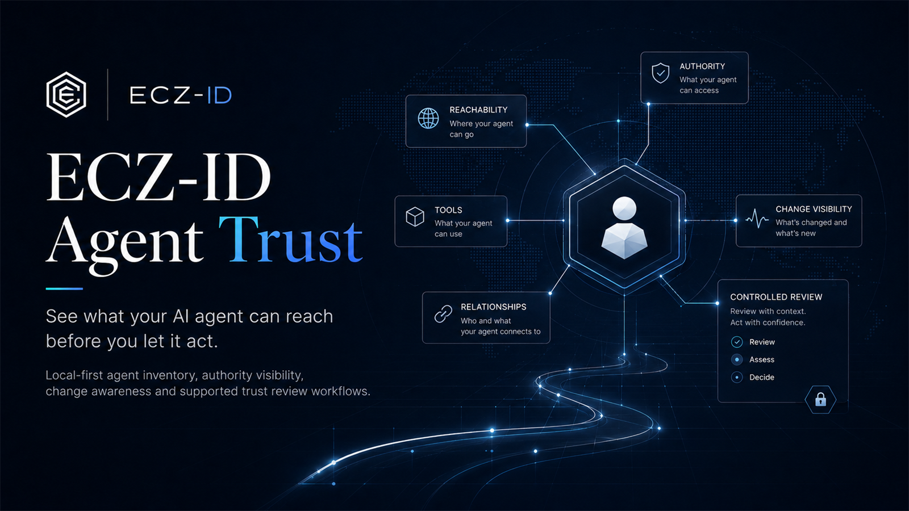

# ECZ-ID Agent Trust

**See what your AI agent can reach before you let it act.**

Official public product and documentation home for **ECZ-ID Agent Trust**.

[Visual Studio Marketplace](https://marketplace.visualstudio.com/items?itemName=ecocitizenz.eczid-ai-agents) | [Open VSX](https://open-vsx.org/extension/ecocitizenz/eczid-ai-agents) | [Product page](https://developers.ecocitizenz.com/agent-trust/) | [Get a free Agent Passport](https://developers.ecocitizenz.com/quickstarts/agent/?utm_source=github&utm_medium=repository&utm_campaign=agent-trust&utm_content=free-passport) | [Developer Trust suite](https://developers.ecocitizenz.com/developer-trust/)

> Extension binaries are distributed through the marketplaces above. This repository is the official public product/documentation home and does not imply that proprietary extension source code is published here.

## What it is for

Agent Trust gives developers and reviewers a local-first way to inspect supported AI-agent configuration and declared access surfaces before granting trust.

### Agent Trust Community — free local review

Current Community capability includes:

- per-agent inventory / Agent X-Ray for supported surfaces,
- declared tool visibility,
- environment key-name exposure,
- workspace MCP relationships,
- local change detection,
- VS Code Workspace Trust handling,
- `ecz-agent.json` validate/scaffold on explicit request,
- local-first processing with no telemetry.

Community remains usable without a paid Developer Trust entitlement.

For current shipped capability, pricing, and plan availability use the canonical product page:

https://developers.ecocitizenz.com/agent-trust/

## Free Agent identity

If you operate an AI agent, one logical agent can receive one free ECZ-ID Agent Passport. The live public journey also creates a free Business Passport when the organisation does not already have one; no payment is taken for the free Passport journey.

[Start with the Agent Passport quickstart →](https://developers.ecocitizenz.com/quickstarts/agent/?utm_source=github&utm_medium=repository&utm_campaign=agent-trust&utm_content=identity)

The Passport provides identity and a public location for re-checkable current state. It is not a claim that the agent is safe, approved, certified or compliant.

## Agent Trust Pro

**Agent Trust Pro** is the optional paid local Developer Trust software layer inside the existing Agent Trust extension. It adds the established advanced local controls, including:

- Authority Graph;
- Authority Epochs / local history and comparison;
- dangerous action-chain indicators;
- reciprocal Agent-to-MCP visibility;
- reviewable local remediation and related local controls.

Agent Trust Pro does not create, replace or meter the free Agent Passport and does not create canonical Resolver truth.

**Developer Trust Pro Bundle** unlocks both Agent Trust Pro and MCP Trust Pro.

[Explore Developer Trust →](https://developers.ecocitizenz.com/developer-trust/)

## Separate organisational product: KYA Authority

**KYA Authority is separate from Agent Trust Pro.** It is a higher-level organisational agent-governance / authority product. It is not the customer-facing name of the `AGENT_TRUST_PRO` software entitlement.

KYA Authority may be relevant when an organisation needs broader governance or authority operations beyond local developer inspection and controls. Buying one product does not silently create or rename the other.

## Product boundary

| Layer | Product / capability |
|---|---|
| Free local review | Agent Trust Community |
| Free durable identity | Agent Passport |
| Optional paid local Developer Trust software | Agent Trust Pro |
| Optional paid Developer Trust bundle | Developer Trust Pro Bundle — Agent Trust Pro + MCP Trust Pro |
| Separate higher-level organisational product | KYA Authority |
| Public proof | ECZ-ID Resolver |

These layers can work together, but they are not aliases for one another.

## Trust boundary

Agent Trust inspects and explains locally. It does not itself issue ECZ-ID proof, write canonical ECZ-ID truth, certify an agent as safe, or claim universal runtime enforcement.

Resolver is the public proof surface for ECZ-ID evidence.

## Related ECZ-ID GitHub resources

- [Agent Authority Toolkit](https://github.com/EcoCitizenz-Ltd/eczid-agent-authority-toolkit)
- [MCP Security Toolkit](https://github.com/EcoCitizenz-Ltd/eczid-mcp-security-toolkit)
- [Agent Trust GitHub App](https://github.com/marketplace/ecz-id-agent-trust)
- [MCP & Agent Check](https://github.com/marketplace/ecz-id-mcp-agent-check)

## Public identity evidence

**ECZ-ID public identity evidence - ECZ-GB-RBS1NW**

[View current public identity and evidence](https://resolver.ecocitizenz.org/p/ECZ-GB-RBS1NW)

## Product identity

- Product: **ECZ-ID Agent Trust**
- Marketplace identity: `ecocitizenz.eczid-ai-agents`
- Publisher: **EcoCitizenz**
- Product family: **ECZ-ID Developer Trust**
- Company: **EcoCitizenz Ltd**

## Support

See [SUPPORT.md](SUPPORT.md), [SECURITY.md](SECURITY.md), and [PRIVACY.md](PRIVACY.md).
